# The upload, step by step (pictures)

Made on 11 Nov 2026 with `tests/upload_gallery.py`, using the song "Live Footage of Me Ruining This" (VOLUPTRA) and the stand-in server.

**Layout decision (Robert, 11 Nov 2026):** layout A, the 8 short steps shown here, is the one we keep. Layouts B and C at the end are pictures only, kept in case we want to change later.

## Where Upload is: the button in the top bar.

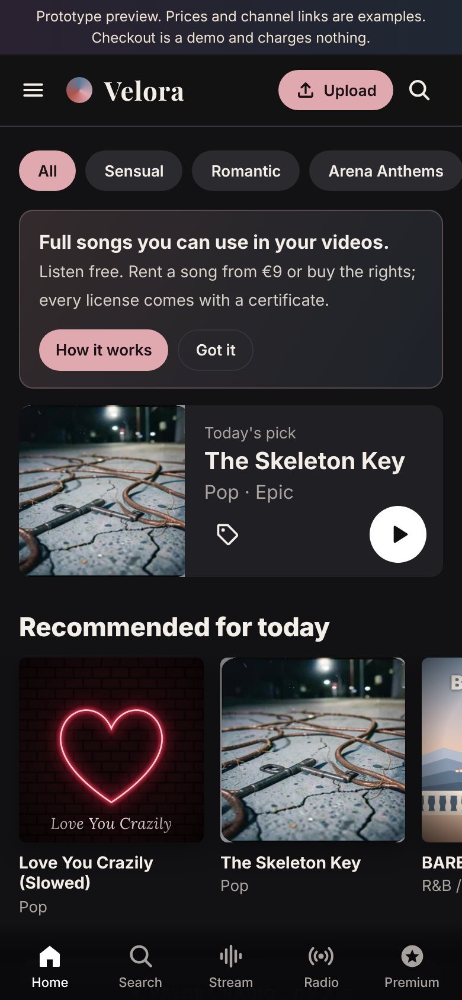

## And first in the menu.

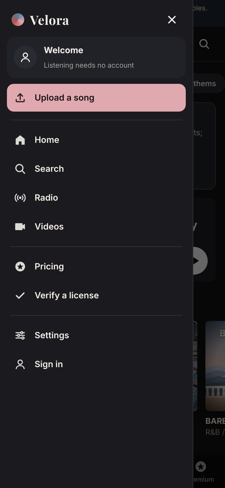

## First time only: the owner account (with the setup code).

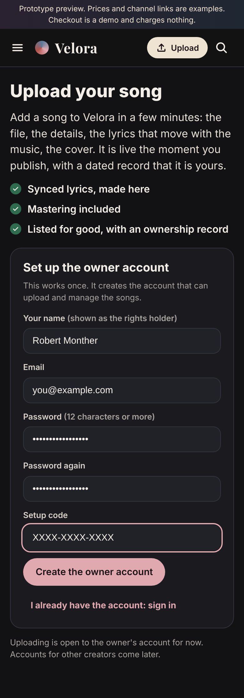

## Step 1, Song file: empty.

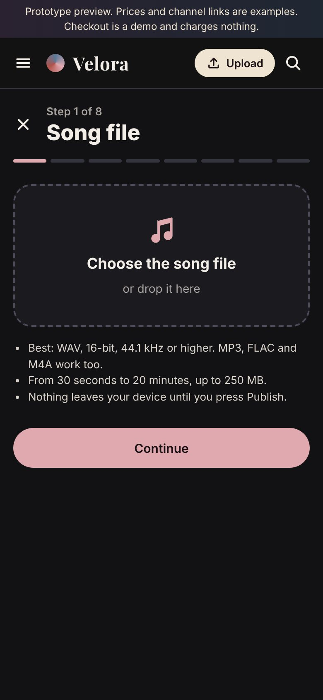

## Step 1: the file is read (format, length, loudness).

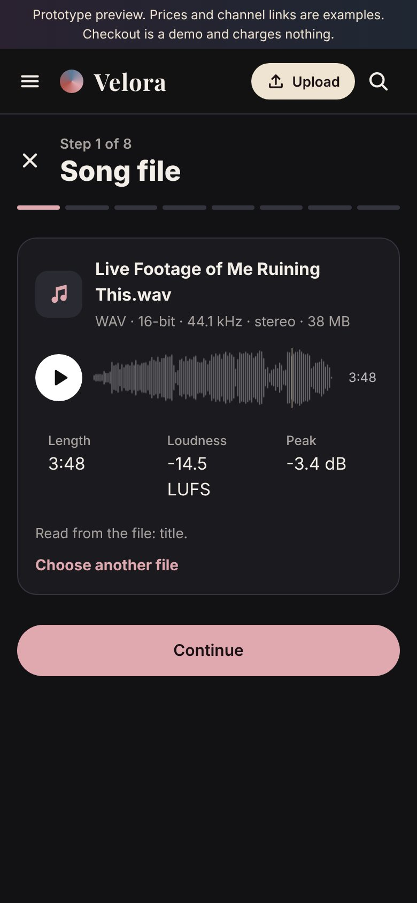

## Step 2, Song details.

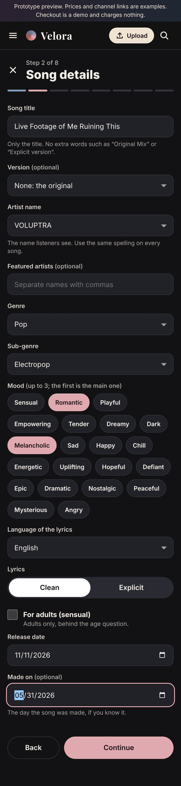

## Step 3, Credits and AI.

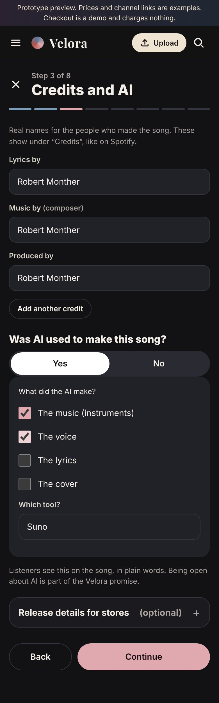

## Step 3: release details for stores (folded, optional).

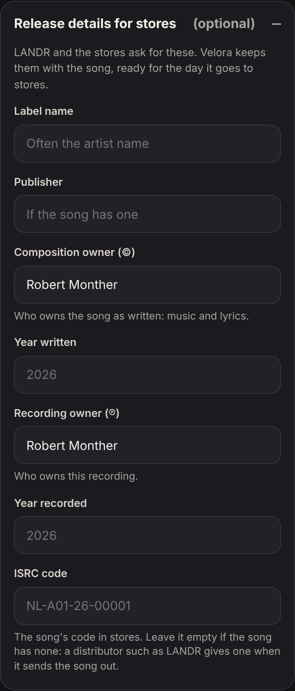

## Step 4, Lyrics.

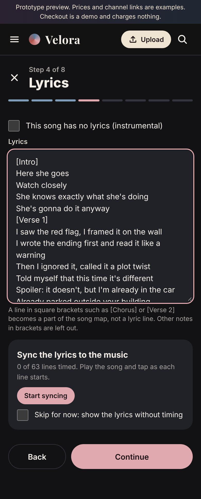

## Step 4: syncing by tapping.

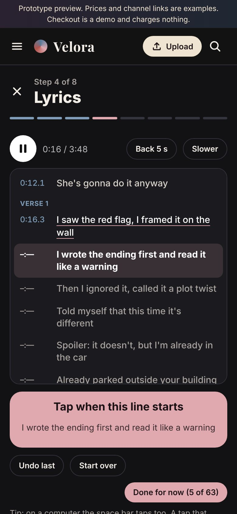

## Step 4: synced.

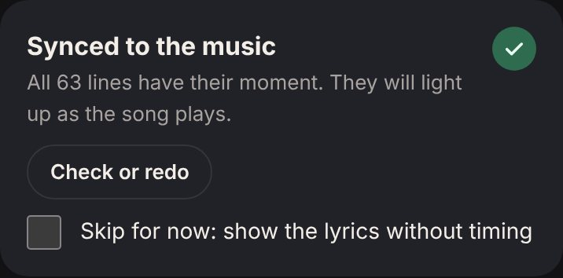

## Step 5, Cover: checked by LANDR's rule (this one is too small for stores).

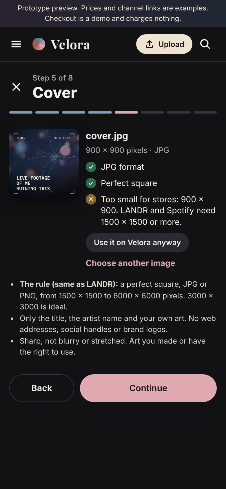

## Step 5: used on Velora only.

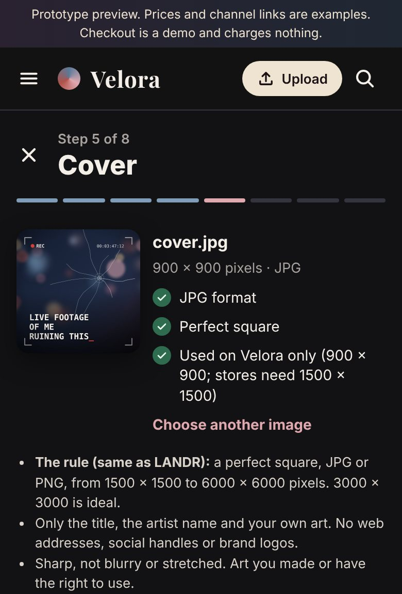

## Step 6, Mastering.

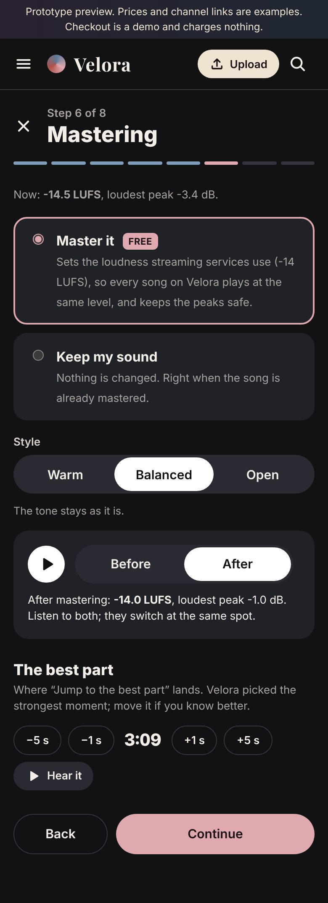

## Step 7, Rights.

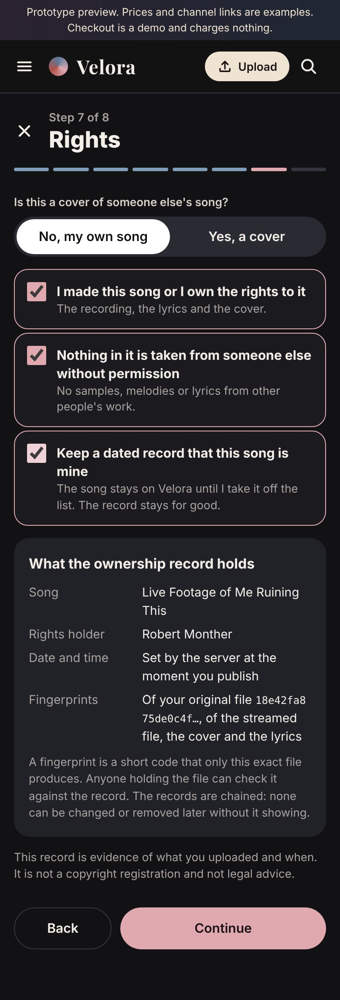

## Step 8, Artist and publish.

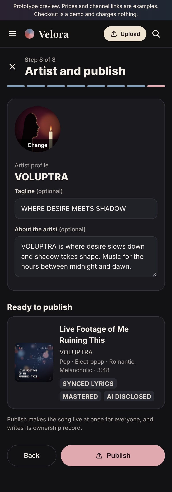

## Publishing.

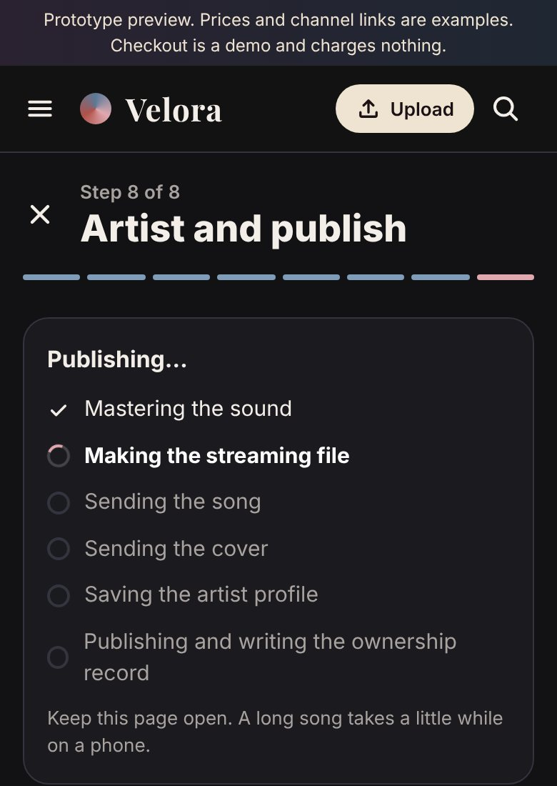

## Published, with the ownership record.

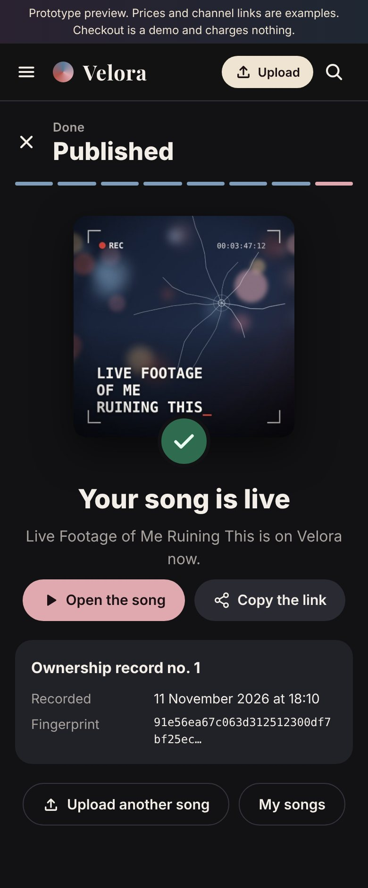

## The song page.

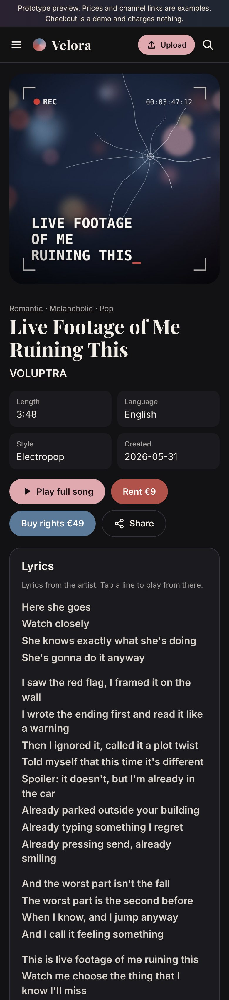

## The full ownership record.

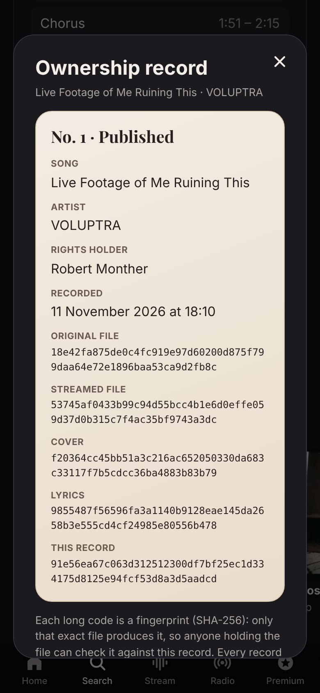

## Lyrics that move with the song.

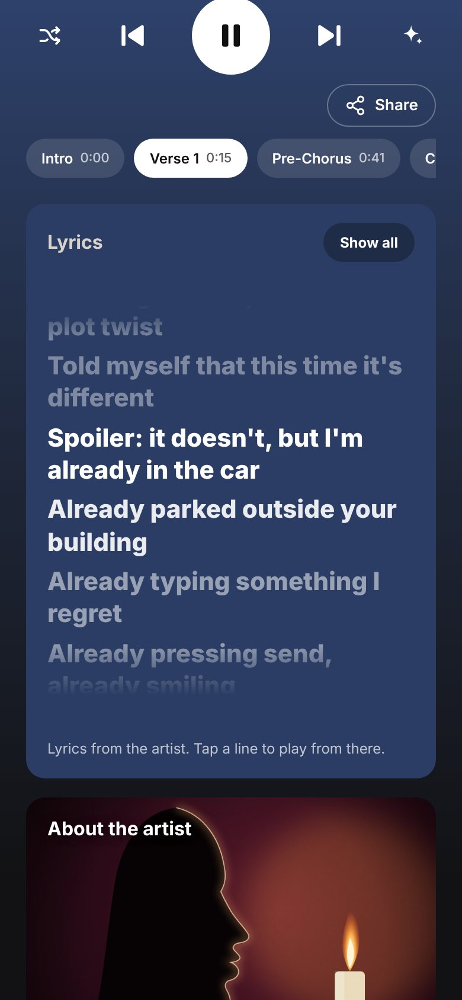

## My songs.

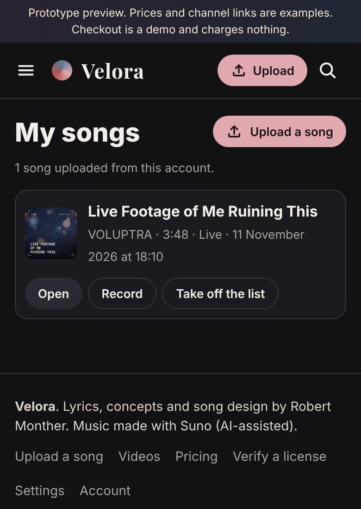

## Layout B (picture only, not built): one page with sections.

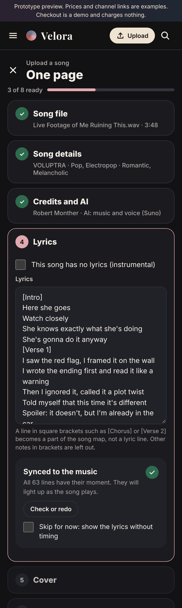

## Layout C (picture only, not built): three screens.

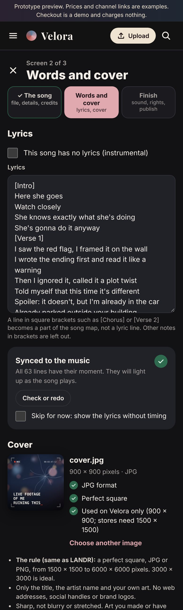
